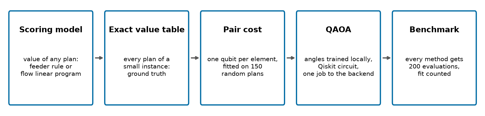
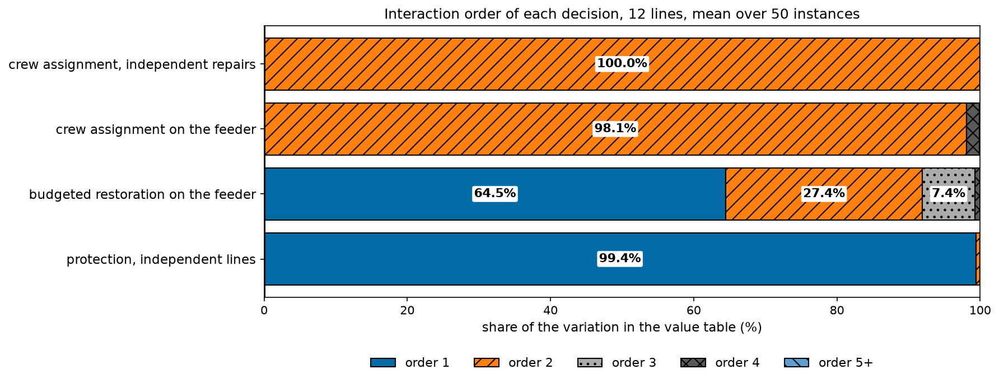
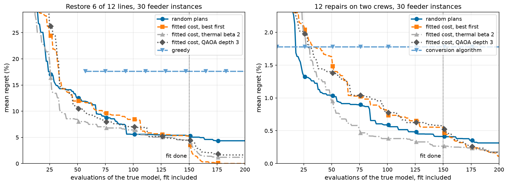
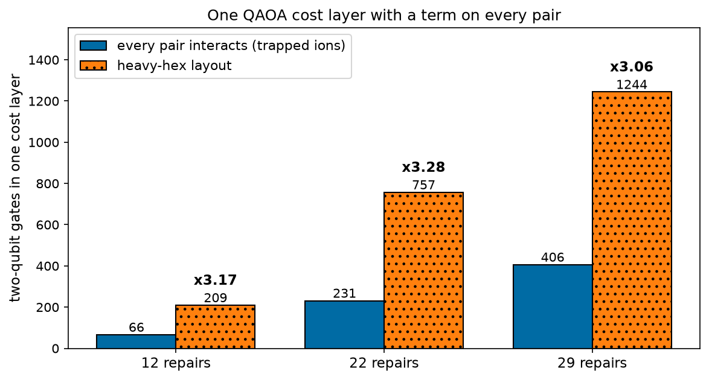
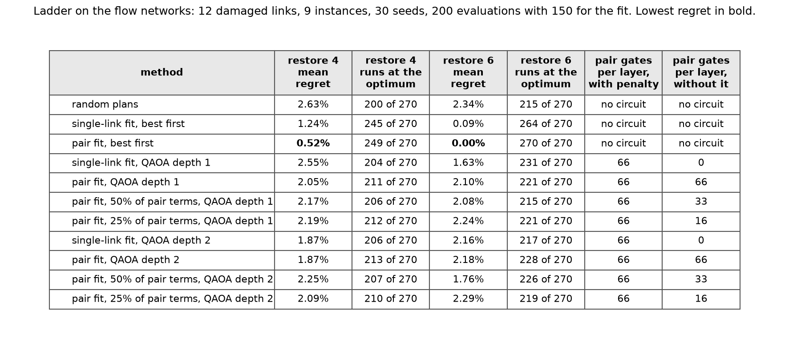

# Figures

## Figure 1: pipeline



**Caption.** Every method, classical or quantum, is scored on the true model with the same budget of 200 evaluations, and the 150 used to fit the pair cost count against it.

**Description.**

```
1. Scoring model: value of any plan: feeder rule or flow linear program
2. Exact value table: every plan of a small instance: ground truth
3. Pair cost: one qubit per element, fitted on 150 random plans
4. QAOA: angles trained locally, Qiskit circuit, one job to the backend
5. Benchmark: every method gets 200 evaluations, fit counted
```

## Figure 2: interaction_spectrum



**Caption.** A pair cost captures orders 1 and 2 only. Those orders hold 98.1% of the variation for crew assignment on the feeder and 100.0% for protection, but 91.9% for budgeted restoration, where 8.2% sits at order 3 and above.

**Description.**

```
decision                                   order 1   order 2   order 3   order 4  order 5+
crew assignment, independent repairs          0.0%    100.0%      0.0%      0.0%      0.0%
crew assignment on the feeder                 0.0%     98.1%      0.0%      1.8%      0.1%
budgeted restoration on the feeder           64.5%     27.4%      7.4%      0.8%      0.0%
protection, independent lines                99.4%      0.6%      0.0%      0.0%      0.0%
```

## Figure 3: budget_curves



**Caption.** After 200 evaluations, the 150 for the fit included, the fitted pair cost with best-first selection has mean regret 0.00% on restoration against 4.35% for random plans. QAOA at depth 3 and a classical thermal sampler on the same cost end close together: 1.64% and 1.19% on restoration, 0.17% and 0.18% on crew assignment.

**Description.**

```
Restore 6 of 12 lines: regret in percent, median (lower to upper quartile) and mean
method                                                    50                           100                           150                           200
random plans                     8.39 ( 4.77 to  14.95)  12.62   4.78 ( 1.41 to   6.60)   5.58   4.66 ( 1.41 to   6.45)   5.31   3.72 ( 0.16 to   5.92)   4.35
fitted cost, best first         10.17 ( 6.30 to  13.23)  11.95   5.92 ( 2.08 to  11.16)   8.44   3.63 ( 1.34 to   9.18)   5.25   0.00 ( 0.00 to   0.00)   0.00
fitted cost, thermal beta 2      6.62 ( 3.59 to  10.72)   8.45   4.52 ( 2.95 to   9.19)   6.39   3.78 ( 1.48 to   6.35)   4.33   0.00 ( 0.00 to   2.48)   1.19
fitted cost, thermal beta 5      8.91 ( 5.14 to  13.22)  14.38   5.35 ( 3.19 to   8.36)   8.13   4.25 ( 2.81 to   6.05)   4.78   0.00 ( 0.00 to   0.48)   0.91
fitted cost, QAOA depth 1       10.20 ( 5.69 to  13.94)  11.81   6.27 ( 4.19 to   9.88)   7.10   6.00 ( 3.08 to   8.29)   5.89   3.13 ( 1.25 to   6.14)   3.85
fitted cost, QAOA depth 2        7.59 ( 2.98 to  15.46)  10.48   3.87 ( 0.31 to   8.80)   4.90   3.18 ( 0.00 to   6.50)   3.67   2.60 ( 0.00 to   4.59)   2.98
fitted cost, QAOA depth 3       10.83 ( 4.53 to  12.65)  10.82   5.43 ( 0.76 to   8.43)   6.98   4.16 ( 0.23 to   7.24)   4.45   0.00 ( 0.00 to   2.93)   1.64
greedy                                                  none   0.00 ( 0.00 to  47.43)  17.63   0.00 ( 0.00 to  47.43)  17.63   0.00 ( 0.00 to  47.43)  17.63
largest weights                 85.26 (15.47 to 100.00)  64.11  85.26 (15.47 to 100.00)  64.11  85.26 (15.47 to 100.00)  64.11  85.26 (15.47 to 100.00)  64.11

12 repairs on two crews: regret in percent, median (lower to upper quartile) and mean
method                                                    50                           100                           150                           200
random plans                     0.73 ( 0.33 to   1.48)   1.04   0.39 ( 0.25 to   0.84)   0.59   0.34 ( 0.12 to   0.62)   0.41   0.26 ( 0.08 to   0.45)   0.31
fitted cost, best first          1.06 ( 0.54 to   2.28)   1.63   0.46 ( 0.23 to   0.90)   0.77   0.39 ( 0.15 to   0.64)   0.55   0.00 ( 0.00 to   0.12)   0.11
fitted cost, thermal beta 2      0.44 ( 0.24 to   1.30)   0.95   0.30 ( 0.11 to   0.48)   0.38   0.25 ( 0.08 to   0.37)   0.26   0.12 ( 0.00 to   0.25)   0.18
fitted cost, thermal beta 5      1.16 ( 0.52 to   1.50)   1.22   0.43 ( 0.19 to   0.78)   0.54   0.42 ( 0.19 to   0.77)   0.50   0.10 ( 0.00 to   0.28)   0.17
fitted cost, QAOA depth 1        0.57 ( 0.28 to   1.24)   0.93   0.28 ( 0.13 to   0.53)   0.41   0.28 ( 0.09 to   0.43)   0.33   0.14 ( 0.03 to   0.29)   0.23
fitted cost, QAOA depth 2        0.77 ( 0.29 to   1.32)   0.94   0.48 ( 0.11 to   0.93)   0.60   0.25 ( 0.05 to   0.47)   0.36   0.09 ( 0.00 to   0.28)   0.16
fitted cost, QAOA depth 3        0.88 ( 0.41 to   1.82)   1.38   0.55 ( 0.19 to   1.16)   0.78   0.36 ( 0.12 to   0.65)   0.58   0.11 ( 0.03 to   0.28)   0.17
conversion algorithm             0.54 ( 0.06 to   2.41)   1.78   0.54 ( 0.06 to   2.41)   1.78   0.54 ( 0.06 to   2.41)   1.78   0.54 ( 0.06 to   2.41)   1.78
```

## Figure 4: gate_counts



**Caption.** A cost layer with a term on every pair needs 3.06 to 3.28 times as many two-qubit gates on a heavy-hex layout as on a device where every pair of qubits interacts: 209 against 66 at 12 repairs. At IonQ Forte's two-qubit error rate, 72% of shots pass that layer without a two-qubit error.

**Description.**

```
 repairs  all pairs  depth  heavy hex  depth  ratio  shots without error
      12         66     21        209     99   3.17                  72%
      22        231     41        757    204   3.28                  32%
      29        406     55       1244    266   3.06                  13%
```

## Figure 5: flow_ladder



**Caption.** On the flow networks no QAOA rung beats the pair fit with best-first selection. After 200 evaluations it has mean regret 0.52% (restore 4) and 0.00% (restore 6), against 2.63% and 2.34% for random plans; the best QAOA rung reaches 1.87% (single-link fit, QAOA depth 2 or pair fit, QAOA depth 2) and 1.63% (single-link fit, QAOA depth 1). Keeping fewer fitted pair terms does not save gates: the count penalty for restoring 4 and 6 links puts a term on every pair, 66 pair gates per layer.

**Description.**

```
method                                         restore 4 mean regret  restore 4 runs at the optimum  restore 6 mean regret  restore 6 runs at the optimum  pair gates per layer, with penalty  pair gates per layer, without it
random plans                                                   2.63%                     200 of 270                  2.34%                     215 of 270                          no circuit                        no circuit
single-link fit, best first                                    1.24%                     245 of 270                  0.09%                     264 of 270                          no circuit                        no circuit
pair fit, best first                                           0.52%                     249 of 270                  0.00%                     270 of 270                          no circuit                        no circuit
single-link fit, QAOA depth 1                                  2.55%                     204 of 270                  1.63%                     231 of 270                                  66                                 0
pair fit, QAOA depth 1                                         2.05%                     211 of 270                  2.10%                     221 of 270                                  66                                66
pair fit, 50% of pair terms, QAOA depth 1                      2.17%                     206 of 270                  2.08%                     215 of 270                                  66                                33
pair fit, 25% of pair terms, QAOA depth 1                      2.19%                     212 of 270                  2.24%                     221 of 270                                  66                                16
single-link fit, QAOA depth 2                                  1.87%                     206 of 270                  2.16%                     217 of 270                                  66                                 0
pair fit, QAOA depth 2                                         1.87%                     213 of 270                  2.18%                     228 of 270                                  66                                66
pair fit, 50% of pair terms, QAOA depth 2                      2.25%                     207 of 270                  1.76%                     226 of 270                                  66                                33
pair fit, 25% of pair terms, QAOA depth 2                      2.09%                     210 of 270                  2.29%                     219 of 270                                  66                                16
```
